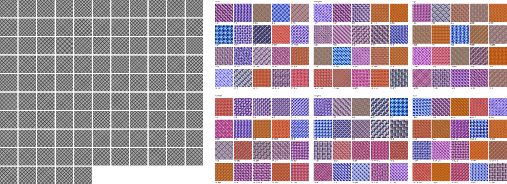
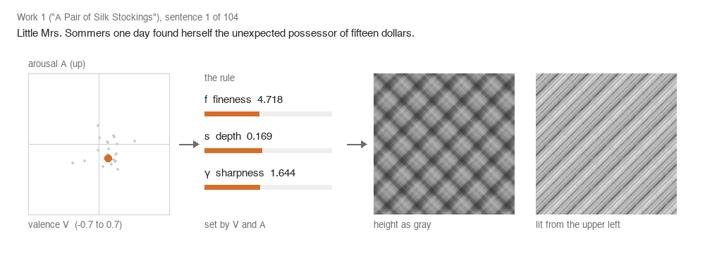
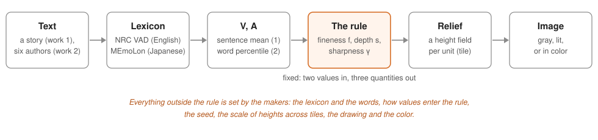

<h1 align="center">What Makers Chose, and When</h1>

<p align="center">
  語の感情の値から作った 2 つのレリーフの連作のスクリプト・条件・結果と、<br>
  各量をいつ決めたかの記録。
</p>

<p align="center">
  <a href="LICENSE"></a>
  <a href="LICENSE-docs"></a>
  
  <a href="https://docs.astral.sh/uv/"></a>
  
  <a href="https://doi.org/10.5281/zenodo.23814559"></a>
</p>

<p align="center"><a href="README.md">English</a> | <b>日本語</b></p>

このリポジトリは論文 *What Makers Chose, and When: Noting the Quantities a Rule Leaves Open*（Mikoto Miura・Yuusuke Harada、2026 年 10 月 31 日に *Leonardo* に投稿、査読前のプレプリント [10.5281/zenodo.23829420](https://doi.org/10.5281/zenodo.23829420)）の補足 S3 です。

<p align="center">
  
</p>
<p align="center"><sub><b>作品 1</b>（左）: Kate Chopin "A Pair of Silk Stockings" の 104 文を 1 文 1 枚のタイルに。
<b>作品 2</b>（右）: 日本の作家 6 人の肖像、各 20 語。いずれもデジタル画像、2026 年、&copy; 著者。</sub></p>

## 1 文がタイルになるまで

<p align="center">
  
</p>

作品 1 の各文は、辞書にある語の感情価 *V* と覚醒度 *A* の平均を持ちます。1 つの規則がそれを高さの場の細かさ *f*・深さ *s*・鋭さ γ に変え、場は灰色（暗いほど低い）か、光を当てたレリーフとして描かれます。アニメーションは `results/work1/work1.json` に記録された値で最初の 24 文をたどります。`tools/readme_media.py` で作った説明用の図で、論文の数値はここから取っていません。

<p align="center">
  
</p>

規則は 2 つの値から 3 つの量を決めます。画像の見え方を変えるそれ以外のもの（辞書、値の入れ方、種、タイルをまたぐ高さの尺度、描き方、色）は作り手に残されます。論文は、それぞれの量について、出力を見る前に決めたか後に決めたか、どの画像に使ったかを記録しています（表 1）。

## 論文の図と表の出どころ

論文の計算はすべて、スクリプトを初めて走らせる前に git にコミットした条件の上で行いました。結果には、条件・スクリプト・入力の SHA-256 と git のコミットが記録されています。条件の前の版はそのファイルの履歴にあります（`git log -- works/conditions/<name>.json`）。

| 論文 | スクリプト | 条件 | 結果 |
|---|---|---|---|
| 図 1 | `works/rule_schematic.py` | `works/conditions/rule_schematic.json` | `results/rule_schematic_v6/` |
| 図 2・3 | `works/work1.py` | `works/conditions/work1.json` | `results/work1/`（`common.png`・`minmax.png`） |
| 図 4 | `works/work1_drawing.py` | `works/conditions/work1_drawing.json` | `results/work1_drawing/` |
| 図 5 | `works/work2_sp_color.py` | `works/conditions/work2_sp_color.json` | `results/work2_sp_color/SPC.png` |
| 図 6 | `works/paper_figure6_scale.py` | `works/conditions/paper_figure6_scale.json` | `results/paper_figure6_scale/` |
| 表 1 | `works/decision_note.py` | `works/conditions/decision_note.json` | `results/decision_note_v23/` |

補足 S1・S2 は `results/` のほかのディレクトリを名前で引きます。`checks/` には作品の前に行った確かめ（規則の論文の文章の例の再現、日本語の対応の感度、物語の流れなど）があります。

## このアーカイブに入れていないものと理由

| 入れていないもの | 理由 | 代わりにここにあるもの |
|---|---|---|
| `external/`（辞書と文章）。翻訳 3 本を除く | NRC VAD Lexicon は再配布できない。ほかは入手元に置いてある | `external-manifest.tsv`: スクリプトと条件が名指す 32 ファイルのパス・SHA-256・大きさ・入手元。著作権の切れた『人魚姫』の英訳 3 本は、Wikisource からの取り出しをバイト単位で繰り返せないので `external/translations-20261028/little-mermaid/` に入れた（`checks/reference_stretch.py` は青空文庫のファイルを自分で取り、URL と SHA-256 を `results/reference_stretch.json` に記録する） |
| 翻訳者の連作の下絵の記録 2 つ（`results/sketch_translations_words*/`）にある NRC VAD Lexicon の値と、それを逆算できる量（*s*・γ・D による高さの変化） | 使用条件「Do not redistribute the data」 | その値を `null` にし、語をまたぐ集計は残した同じ記録（`tools/lexicon_values.py`）。辞書があれば `restore` で元のファイルとバイト単位で同じに戻る |
| `results/sketch_translations_words_d/words_vad.png` | 札に 60 語の dominance の値が描かれている | `words_vad_unlabelled.png`: 同じタイルで札は語だけ（`tools/words_vad_unlabelled.py`） |
| 作業記録（`advice/`・`handoff/`・`.steering/`）と大きな生成物（`output/`） | 作業の記録で、計算の入力ではない | いくつかの条件は判断の場所としてこれらを名指すが、名前だけで、計算には要らない |

残したものとその理由: 図は値を描いています。`results/sketch_translations_words/words.png`・`results/sketch_translations_words_d/pairs.png`・`words_vad_unlabelled.png` の語ごとのタイルは辞書の値から規則で作られ、生成器と種は公開されているので、図から値を推定することはできます。辞書から描いた図の常として作品の図として残し、辞書の値を数字として印字・保存したものはありません。作品 1 のタイルと文の記録は、文の中の語の平均です（作品 1 に一致した語が 1 つだけの文はありません）。`checks/reference/text_path_example.json` は規則の論文とともに公開済みの結果（[affective-relief-audit](https://doi.org/10.5281/zenodo.23681773) の `results/text_path_example.json`）の写しで、新たに配るものではありません。

`results/blind_judgement/score.json`・`results/sketch_translations_words/sketch_translations_words.json`・`results/sketch_translations_words_d/sketch_translations_words_d.json`・`results/sketch_translations_words_d/words_vad.png` の 4 ファイルは、版 0.1.0 として公開した履歴のすべてのコミットから除きました。それ以外は、計算を行ったときの履歴そのままです（下記）。

盲検の集計 `results/blind_judgement/score.json` は、第 2 著者の項目ごとの答えと書き込み（日本語）を含むので版 0.1.0 には入れず、本人の承諾の後、版 0.2.0 で履歴の上に新しいコミットとして足しました。結果が SHA-256 を記録しているファイル（d98dccf5…）とバイト単位で同じです。これと外部のファイルがあれば、`works/decision_note.py`（表 1）と `works/paper_work2_figures.py` は記録の図と表をもう一度出します（両方を確かめました。違うのは `meta` の時刻とコミットだけです）。`works/blind_judgement_score.py` と `works/blind_judgement_score_supplement.py` は判定者の回答の表計算ファイルを読み、それはこのアーカイブに無いので、ここからは走らせ直せません。書き込みに触れていたコミットのメッセージ 2 本は注記に置き換えたままで、元には戻していません。

## 再現

必要なもの: macOS（図は条件に書いた macOS のフォントで描く。テストと実行はすべて Apple silicon の macOS。結果は環境と使ったフォントの SHA-256 を記録し、図がバイト単位で同じになるのは同じフォントのときだけ）、[uv](https://docs.astral.sh/uv/)、git。生成器 `atact` は公開リポジトリから固定したコミットで入ります（`pyproject.toml`。保管先 [10.5281/zenodo.23681773](https://doi.org/10.5281/zenodo.23681773)）。

```bash
uv sync --frozen                                          # Python 3.13 と uv.lock の固定版
uv run --frozen pytest                                    # 300 テストが通る。8 つは openpyxl か trimesh が要り飛ばされる
uv run --with openpyxl --with trimesh pytest              # 2 つを足すと 308 すべて（版は固定していない）
```

スクリプトを走らせるには、外部ファイルを `external-manifest.tsv` のパスに置き、SHA-256 を照合します。

```bash
tail -n +2 external-manifest.tsv | awk -F'\t' '{print $2"  "$1}' | shasum -a 256 -c -
uv run python works/work1.py                              # 上書きしない。先に results/work1/ を退避する
```

NRC の辞書を置けば、`uv run python tools/lexicon_values.py restore` が 2 つの記録に値を戻し、両方が元の SHA-256 になったときだけ書きます（第 3 の入力の記録は、そのスクリプト `works/sketch_translations_words_d.py` で計算し直します）。書く途中で止まったら、もう一度走らせてください。公開した記録を辞書と照らし合わせるためのものです。追跡しているファイルを書き換え、スクリプトは入力が最後のコミットと同じかを確かめるので、戻したファイルを手元のブランチでコミットしてから、それを読むスクリプトを走らせてください。

入手元についての注意: 3 つの翻訳は Wikisource の記載の版から HTML を文字にして取ったもので、このアーカイブに入れています。青空文庫の一覧は時とともに変わります。使った写し（2026-08-22 付）は SHA-256 で特定し、後の写しではそれを読むスクリプトが止まります。入力が条件の SHA-256 と違えば、スクリプトは止まります。

## 履歴と来歴

結果は、計算を行った作業用リポジトリのハッシュでコミットを引きます。この履歴はそのリポジトリから、この 4 ファイルをすべてのコミットから除き、作者のメールアドレスを 1 つにそろえて作りました。日付と順序は変えておらず、メッセージも上に記した 2 本を除いて変えておらず、`score.json` だけを足していたコミットは空のまま残しています。`commit-map.tsv` が元のハッシュとここのコミットを対応させます。対応表の最後のコミットより後は、この節のツール、値を外した記録、札を直した図、翻訳 3 本、この README を足すコミットと、版 0.2.0 で `score.json` を足すコミット、版 0.2.1 で論文の投稿とプレプリントを記すコミットです。

版: 0.1.0（[10.5281/zenodo.23814560](https://doi.org/10.5281/zenodo.23814560)）、0.2.0（`score.json` を足した版。[10.5281/zenodo.23828355](https://doi.org/10.5281/zenodo.23828355)）、0.2.1（論文の投稿とプレプリントを記した版。[10.5281/zenodo.23830047](https://doi.org/10.5281/zenodo.23830047)）。[10.5281/zenodo.23814559](https://doi.org/10.5281/zenodo.23814559) は最新の版を指します。

## 引用

論文とこのアーカイブを引いてください（`CITATION.cff` にもあります）。

> Miura, M. and Harada, Y. What Makers Chose, and When: Noting the Quantities a Rule Leaves Open. Submitted to *Leonardo*.
> Preprint, Zenodo, 2026. https://doi.org/10.5281/zenodo.23829420

> Miura, M. and Harada, Y. (2026). Scripts, conditions and results of "What Makers Chose, and When". Zenodo.
> https://doi.org/10.5281/zenodo.23814559

規則は第 2 著者のプレプリントによります。

> Harada, Y. (2026). Affective Tactility: Cross-Modal Translation from Natural Language to Procedural Height Maps.
> Preprint, Research Square. https://doi.org/10.21203/rs.3.rs-8696852/v1

辞書: Mohammad, S. M. NRC VAD Lexicon v2.1（National Research Council Canada）、Buechel, S., Rücker, S. and Hahn, U. (2020), Learning and Evaluating Emotion Lexicons for 91 Languages, ACL 2020（MEmoLon、https://doi.org/10.5281/zenodo.3756607）。

## 使用許諾

コードは MIT License（`LICENSE`）、文書・条件・結果・図は Creative Commons Attribution 4.0 International License（`LICENSE-docs`）です。`LICENSE-docs` には、それぞれの条件のままである他者の素材も書いてあります。NRC VAD Lexicon の値そのものは、その使用条件に従います。

## 著者

- Mikoto Miura、Independent Researcher（[ORCID 0009-0000-4196-0508](https://orcid.org/0009-0000-4196-0508)）
- Yuusuke Harada、Graduate School of Humanities and Social Sciences, Hiroshima University, Japan（[ORCID 0009-0006-7252-5115](https://orcid.org/0009-0006-7252-5115)）
