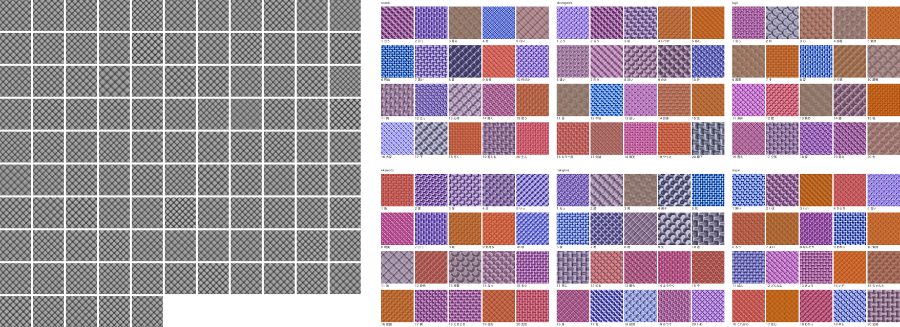
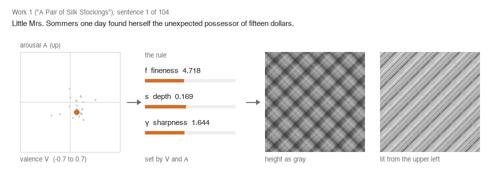
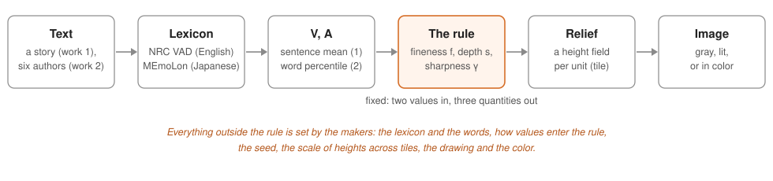

<h1 align="center">What Makers Chose, and When</h1>

<p align="center">
  Scripts, conditions and results of two series of reliefs made from the emotional values of words,<br>
  and the note recording when each of their quantities was set.
</p>

<p align="center">
  <a href="LICENSE"></a>
  <a href="LICENSE-docs"></a>
  
  <a href="https://docs.astral.sh/uv/"></a>
  
  <a href="https://doi.org/10.5281/zenodo.23814559"></a>
</p>

<p align="center"><b>English</b> | <a href="README.ja.md">日本語</a></p>

This repository accompanies the article *What Makers Chose, and When: Noting the Quantities a Rule Leaves Open*
(Mikoto Miura and Yuusuke Harada; manuscript). It is Supplement S3 of the article.

<p align="center">
  
</p>
<p align="center"><sub><b>Work 1</b> (left): the 104 sentences of Kate Chopin's "A Pair of Silk Stockings", one tile each.
<b>Work 2</b> (right): portraits of six Japanese authors, twenty words each. Both: digital images, 2026,
&copy; the authors.</sub></p>

## How a sentence becomes a tile

<p align="center">
  
</p>

Each sentence of work 1 has a mean valence *V* and arousal *A* over the words found in a lexicon. One rule turns
them into the fineness *f*, the depth *s* and the sharpness γ of a height field; the field is drawn as gray (darker is
lower) or lit as a relief. The animation steps through the first 24 sentences with the values recorded in
`results/work1/work1.json`. It is an illustration made by `tools/readme_media.py`; no number of the article comes
from it.

<p align="center">
  
</p>

The rule decides three quantities from two values. Everything else that changes how an image looks (the lexicon,
how values enter the rule, the seed, the scale of heights across tiles, the drawing and the color) is left to the
makers. The article records, for each of these quantities, whether it was set before or after seeing its output and
which images used it (Table 1).

## Where each figure of the article comes from

Every computation of the article was run by a script on conditions committed to git before the script was first
run; the results
record the SHA-256 of the conditions, the script, the inputs and the git commit. Earlier versions of a set of
conditions are in the history of its file (`git log -- works/conditions/<name>.json`).

| Article | Script | Conditions | Results |
|---|---|---|---|
| Fig. 1 | `works/rule_schematic.py` | `works/conditions/rule_schematic.json` | `results/rule_schematic_v6/` |
| Figs. 2, 3 | `works/work1.py` | `works/conditions/work1.json` | `results/work1/` (`common.png`, `minmax.png`) |
| Fig. 4 | `works/work1_drawing.py` | `works/conditions/work1_drawing.json` | `results/work1_drawing/` |
| Fig. 5 | `works/work2_sp_color.py` | `works/conditions/work2_sp_color.json` | `results/work2_sp_color/SPC.png` |
| Fig. 6 | `works/paper_figure6_scale.py` | `works/conditions/paper_figure6_scale.json` | `results/paper_figure6_scale/` |
| Table 1 | `works/decision_note.py` | `works/conditions/decision_note.json` | `results/decision_note_v23/` |

The supplements S1 and S2 cite the other directories of `results/` by name. `checks/` holds the checks run before the
works (the text path of the rule's paper, sensitivity of the Japanese map, the flow of the story and others).

## What is not in this archive, and why

| Left out | Why | What is here instead |
|---|---|---|
| `external/` (lexicons and texts), except the three translations | the NRC VAD Lexicon may not be redistributed; the others are kept at their sources | `external-manifest.tsv`: the path, SHA-256, size and source of each of the 32 files the scripts and conditions name; the three public-domain translations of 'The Little Mermaid' are in `external/translations-20261028/little-mermaid/`, because their extraction from Wikisource cannot be repeated byte for byte (`checks/reference_stretch.py` fetches its Aozora Bunko files itself and records their URLs and SHA-256 in `results/reference_stretch.json`) |
| the values of the NRC VAD Lexicon in two records of the sketch of a series of translators (`results/sketch_translations_words*/`), and the quantities that would give them back (*s*, γ, the change of height by D) | its terms of use: "Do not redistribute the data" | the same records with those values set to `null` and their summaries over the words kept (`tools/lexicon_values.py`); with the lexicon, `restore` gives the original files byte for byte |
| `results/sketch_translations_words_d/words_vad.png` | its labels print the lexicon's dominance for 60 words | `words_vad_unlabelled.png`: the same tiles with the words only (`tools/words_vad_unlabelled.py`) |
| the working notes (`advice/`, `handoff/`, `.steering/`) and the large generated files (`output/`) | notes of the work, not inputs of any computation | some conditions name these notes as the place of a decision; they are named, not needed |

What is kept, and why: the figures draw the values. The tiles of each word in `results/sketch_translations_words/words.png`, `results/sketch_translations_words_d/pairs.png` and `words_vad_unlabelled.png` are made from the lexicon's values by the rule, whose generator and seed are public, so the values could be estimated from them; we keep them as figures of the work, as any figure drawn from a lexicon is, and no value of the lexicon is printed or stored as a number. The tiles of work 1 and the records of its sentences hold means over the words of a sentence (no sentence of work 1 has a single matched word). `checks/reference/text_path_example.json` is a copy of a result already published with the rule's paper (`results/text_path_example.json` of [affective-relief-audit](https://doi.org/10.5281/zenodo.23681773)), not a new release.

The four files `results/blind_judgement/score.json`, `results/sketch_translations_words/sketch_translations_words.json`,
`results/sketch_translations_words_d/sketch_translations_words_d.json` and `results/sketch_translations_words_d/words_vad.png`
were removed from every commit of the history published as version 0.1.0, which is otherwise the history in which the
computations were run (see below).

The scoring of the blind judgement, `results/blind_judgement/score.json`, was left out of version 0.1.0 because it holds
the second author's answer to each item and his remarks (in Japanese); it was added in version 0.2.0, after his
consent, as a new commit on top of the history. It is the file whose SHA-256 the results record (d98dccf5…), byte for
byte. With it and the external files in place, `works/decision_note.py` (Table 1) and `works/paper_work2_figures.py`
give their recorded figures and tables again (we checked both: only the time and the commit in `meta` differ).
`works/blind_judgement_score.py` and `works/blind_judgement_score_supplement.py` read the judges' spreadsheets, which are
not in this archive, and cannot be run again from here. Two commit messages that described the remarks carry a note in
their place; they were not changed back.

## Reproduce

Requirements: macOS (the figures are drawn with the system fonts named in their conditions; the tests and every run
were on macOS, Apple silicon; each result records the platform and the SHA-256 of the font it used, and a figure is the
same byte for byte only with the same font file), [uv](https://docs.astral.sh/uv/), and git. The generator `atact` is installed from
its public repository at a pinned commit (`pyproject.toml`; archived as
[10.5281/zenodo.23681773](https://doi.org/10.5281/zenodo.23681773)).

```bash
uv sync --frozen                                          # Python 3.13 and the pinned packages of uv.lock
uv run --frozen pytest                                    # 300 tests pass; 8 need openpyxl or trimesh and are skipped
uv run --with openpyxl --with trimesh pytest              # all 308, with the two packages added (not pinned)
```

To run a script, put the external files at the paths of `external-manifest.tsv` and check their SHA-256:

```bash
tail -n +2 external-manifest.tsv | awk -F'\t' '{print $2"  "$1}' | shasum -a 256 -c -
uv run python works/work1.py                              # refuses to overwrite: move results/work1/ aside first
```

With the NRC lexicon in place, `uv run python tools/lexicon_values.py restore` puts its values back into the two
records and writes them only if both reach their original SHA-256 (the record of the third input is computed again
by its own script, `works/sketch_translations_words_d.py`); if it stops while writing, run it again; it checks the published records against the
lexicon. It changes tracked files, and the scripts check that their inputs equal the last commit, so commit the
restored files on a local branch before running a script that reads them.

Notes on the sources: the three translations, taken from Wikisource at the revisions named with the HTML stripped to
text, are in this archive. The Aozora Bunko list changes over time; its SHA-256 identifies the copy used (dated
2026-08-22), and a later copy will stop the scripts that read it. The scripts stop if an input differs from the SHA-256 in their conditions.

## History and provenance

The results cite commits by their hashes in the working repository in which the computations were run. This history
was prepared from that repository by removing those four files from every commit and by setting one author
e-mail; the dates and the order are unchanged, the messages are unchanged except the two noted above, and the commit
that had added only `score.json` is kept empty. `commit-map.tsv` maps each original hash to the commit here. The commits after the last mapped one add the
tools of this section, the stripped records, the relabelled figure, the three translations and this README, and, in
version 0.2.0, `score.json`.

Versions: 0.1.0 ([10.5281/zenodo.23814560](https://doi.org/10.5281/zenodo.23814560)); 0.2.0, which adds `score.json`
([10.5281/zenodo.23828355](https://doi.org/10.5281/zenodo.23828355)). [10.5281/zenodo.23814559](https://doi.org/10.5281/zenodo.23814559)
resolves to the latest version.

## Citation

Please cite the article and this archive (also in `CITATION.cff`):

> Miura, M. and Harada, Y. What Makers Chose, and When: Noting the Quantities a Rule Leaves Open. Manuscript.

> Miura, M. and Harada, Y. (2026). Scripts, conditions and results of "What Makers Chose, and When". Zenodo.
> https://doi.org/10.5281/zenodo.23814559

The rule comes from the preprint of the second author:

> Harada, Y. (2026). Affective Tactility: Cross-Modal Translation from Natural Language to Procedural Height Maps.
> Preprint, Research Square. https://doi.org/10.21203/rs.3.rs-8696852/v1

The lexicons: Mohammad, S. M. NRC VAD Lexicon v2.1 (National Research Council Canada), and Buechel, S., Rücker, S.
and Hahn, U. (2020), Learning and Evaluating Emotion Lexicons for 91 Languages, ACL 2020 (MEmoLon,
https://doi.org/10.5281/zenodo.3756607).

## License

The code is released under the MIT License (`LICENSE`). The documents, the conditions, the results and the figures are
released under the Creative Commons Attribution 4.0 International License (`LICENSE-docs`), which also names the
material of others that keeps its own terms; the values of the NRC VAD Lexicon themselves stay under its terms.

## Authors

- Mikoto Miura, Independent Researcher ([ORCID 0009-0000-4196-0508](https://orcid.org/0009-0000-4196-0508))
- Yuusuke Harada, Graduate School of Humanities and Social Sciences, Hiroshima University, Japan
  ([ORCID 0009-0006-7252-5115](https://orcid.org/0009-0006-7252-5115))
